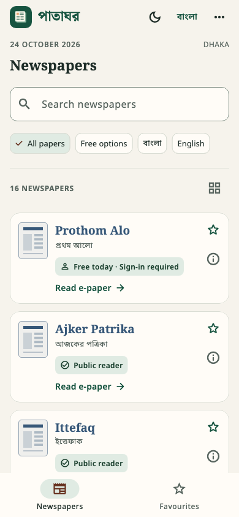
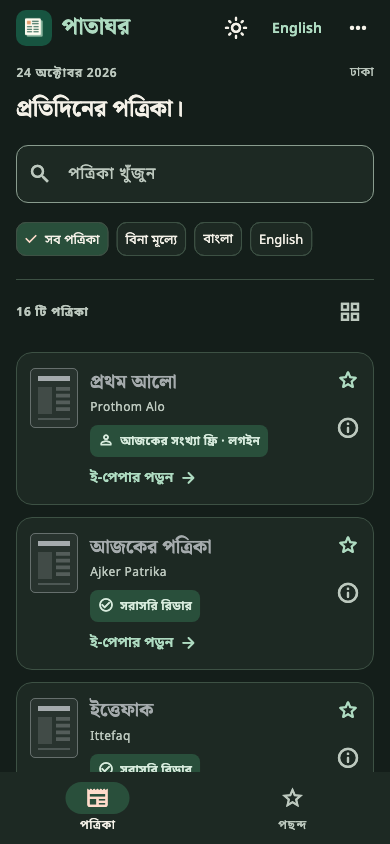

# পাতাঘর · Pataghar

[](https://github.com/ibrahimhasan0012/pataghar/actions/workflows/checks.yml)
[](LICENSE)
[](https://flutter.dev/)

Read official Bangladeshi newspaper e-papers from one Flutter app. Pataghar has a catalogue of 16 publications and a shared reader for Android, iOS and web. It opens each publisher's own print-edition site, so the publisher controls the issue date, navigation, account requirements and access.

[Download the Android preview](https://github.com/ibrahimhasan0012/pataghar/releases/latest) · [Browse the catalogue](assets/papers.json) · [Report an issue](https://github.com/ibrahimhasan0012/pataghar/issues/new/choose)

| Light | Dark · Bangla |
| --- | --- |
|  |  |

These images are Flutter widget renders at phone dimensions. They are not device screenshots.

## What the app does

- Opens the publisher's e-paper in a shared reader, with an option to open the publisher directly.
- Searches newspaper names in Bangla and English and filters by language or available free options.
- Shows access labels so readers can distinguish public readers, sign-in requirements, subscriptions and unverified access.
- Saves favourites, language, theme and the last-opened publication locally.
- Uses touch-friendly rows on phones, a grid on wider screens, bundled Bengali and English fonts, and light and dark themes.

Pataghar does not download issues or bypass publisher logins, paywalls or embedding restrictions. The catalogue is bundled; a publication's current issue and access rules can change without an app update. Check the date and terms on the publisher's page.

## Get the Android app

Download the APK from the [latest release](https://github.com/ibrahimhasan0012/pataghar/releases/latest) and open it on an Android 7.0 or newer device. Android may ask you to allow installation from your browser or file manager. The APK is a preview build signed with a development certificate. It has not been tested on a physical Android device, and it is not a Google Play build.

The repository also contains iOS and web source. iOS needs full Xcode and signing to build for a device.

## Build from source

Install a current [Flutter SDK](https://docs.flutter.dev/get-started/install), the Android SDK and JDK 17 for Android builds. On macOS, install full Xcode for iOS builds.

```sh
flutter pub get
flutter analyze
flutter test
flutter run -d <device-id>
```

Build targets:

```sh
flutter build apk --release
flutter build web
flutter build ios --no-codesign
```

The current Android release configuration signs with a development key. Set up a private production signing key before distributing through an app store. Build checks for source changes run in [GitHub Actions](.github/workflows/checks.yml).

## Catalogue and access

Edit [assets/papers.json](assets/papers.json) to update a publication. Each entry includes an official reader URL, access label, review note, source and date. The review date records when the link and access information were checked; it does not certify that day's issue. See [CONTRIBUTING.md](CONTRIBUTING.md) for the catalogue rules.

The publisher's site may block an embedded reader or sign-in inside a WebView. Use **Open publisher** from the reader when that happens. On web, third-party frame restrictions can also prevent an issue from appearing.

## Privacy and licenses

Favourites, language, theme and the last-opened publication ID are saved on the device or in browser storage. Pataghar has no account, server, analytics or advertising SDK. Publisher pages make their own network requests and may use cookies, accounts and ads.

Original app code and artwork are under the [MIT License](LICENSE). The four bundled Noto fonts have separate SIL Open Font Licenses in [assets/fonts](assets/fonts). The design reference notice is in [design-sources](design-sources). Newspaper names identify their publishers; publisher pages and content are not part of this repository's license.

## Project notes

[DESIGN.md](DESIGN.md) records design decisions and source references. [VERIFICATION.md](VERIFICATION.md) lists completed checks and device-testing limits. Contributions are welcome through [issues](https://github.com/ibrahimhasan0012/pataghar/issues) and [pull requests](CONTRIBUTING.md).
